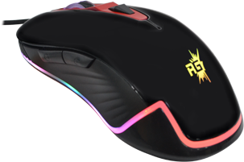

# Redgear X13 Pro utility and OpenMouse driver

Open-source native Windows DPI/polling/RGB utility, TypeScript codec/client and local
OpenMouse integration for the **Redgear X-Series X13 Pro**.

**Working core settings:** DPI, polling, corrected static RGB and standard buttons
are hardware-tested, including the actual OpenMouse UI through native Bridge.
Macros, additional lighting effects and vendor profile interoperability remain incomplete.
This is an independent community project, not an official Redgear release or a
change to OpenMouse's hosted site.



## Tested support

| Setting | Support |
|---|---|
| DPI selection | 400, 800, 1200, 2400, 3200, 4000, 4800; fixed stages |
| Polling | 125, 250, 500, 1000 Hz |
| Physical acceptance | 4000->2400->4000 DPI and 1000->500->1000 Hz; exact full-report read-back |
| OpenMouse / Bridge | Both changes and restoration passed in the real local UI |
| Direct WebHID in tested Edge/Windows | Read fails; safe identity fallback |
| Static RGB | Corrected R,B,G hardware order; green/blue swap fixed |
| Standard buttons | Six buttons; left/right/middle/back/forward/DPI-cycle actions |
| Physical reconnect | Final restored settings retained |
| Macros / extra effects / hardware profiles | Not implemented |
| Windows pointer/precision/scroll/double-click | Native companion panel; affects this Windows user |

Hardware: owner-confirmed wired X13 Pro, USB `1B80:B412`, `MECHREV Gaming Mouse`,
manufacturer `Jtech`. Only interface 01 / collection 03, feature report 3, is used.
Firmware version is unknown. See [protocol](docs/protocol.md) and [testing](docs/testing.md).
`verified:false` remains conservative; per-feature acceptance flags and limits are documented.

## Windows utility

Node.js 20+, npm, Windows PowerShell and the connected mouse are required.
Close the original vendor configurator before writes. No capture driver, Bridge
or administrator rights are needed for the standalone native commands on the tested machine.

```powershell
git clone https://github.com/AniketSpecter/redgear-x13-pro.git
cd redgear-x13-pro
npm ci
npm run check
npm run status
node dist/cli.js help
node dist/cli.js dpi 2400
node dist/cli.js dpi 4000
node dist/cli.js polling 500
node dist/cli.js polling 1000
node dist/cli.js color "#00ff00"
node dist/cli.js windows-settings
```

Each settings command reads the live 40-byte report, changes only the proven
fields and verifies the entire reply. Changes may persist on the mouse. Unsupported
values are refused. No firmware, calibration or report 5/6 writes exist. Report 4 is used only by the
OpenMouse button client, preserving private macro/unknown data.
The `status` and `enumerate` commands are read-only; local evidence stays ignored.
Offline `decode HEX` validates framing and reports the mapped DPI/rate fields.

## OpenMouse

Apply the [pinned source patches](patches/README.md), build the local protocol and
app, and use official OpenMouse Bridge separately on the tested Windows setup.
Seven fixed DPI stage selectors, four polling rates, corrected static colour and
standard button remapping are available. Unknown features remain unavailable. Device artwork uses the specific mouse render the
owner requested; see [artwork provenance](assets/README.md).

The client validates identity/report shape, serializes transfers, reads fresh
before writes, checks full read-back, and stops further writes after transport
failure/mismatch until reconnect. No blind retries or vendor-default replay.

## Development and licensing

`npm run check` builds TypeScript, runs twenty-one focused tests and inspects the
package. CI runs Linux/Windows mocked tests plus Windows native-helper compilation.
Hardware acceptance is documented separately; CI does not access a real mouse.

Code: **AGPL-3.0-or-later**, with OpenMouse attribution in [NOTICE](NOTICE).
The specific vendor avatar retains its original ownership and is not relicensed
as AGPL. No vendor executable, DLL, other skins, firmware, raw USB trace, serial,
credential or Bridge binary is distributed. See [CONTRIBUTING.md](CONTRIBUTING.md).

## Windows controls pictured in the vendor app

Run `node dist/cli.js windows-settings` (or `scripts/windows-settings-ui.ps1`) to
open the native companion. Opening only reads settings; **Apply** writes changed
values and verifies them. Pointer speed, precision, scroll/page amount and double
click affect this Windows user and other attached mice. The panel is compiled from
the included C# source with the Windows .NET Framework compiler; no download,
installation, administrator rights or autostart registration is required.

The APIs are documented by Microsoft: [SystemParametersInfoW](https://learn.microsoft.com/en-us/windows/win32/api/winuser/nf-winuser-systemparametersinfow)
and [SetDoubleClickTime](https://learn.microsoft.com/en-us/windows/win32/api/winuser/nf-winuser-setdoubleclicktime).
